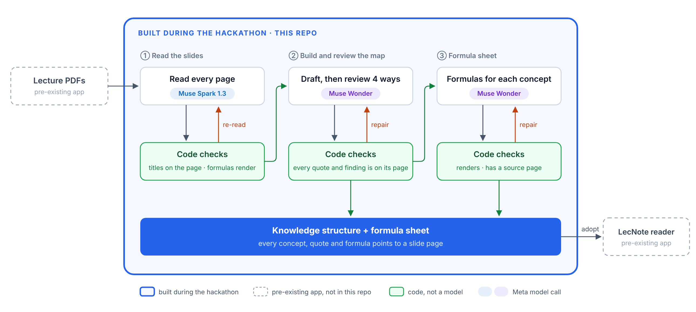

# LecNote

**Study material I can check, in the language I think in.**

I'm an international master's student, studying in English, my second language. Learning a course this way takes three steps: understand an unfamiliar idea, put it in my own words, and connect it with what came in other lectures. LecNote, my macOS app for lecture PDFs, is built around those steps: I can look up a phrase or ask AI about a sentence, formula or diagram with the lecture as context, and keep my own notes beside the slide.

The third step is the hardest. By exam time a course is hundreds of slides, with no map of how they fit together, and a chatbot summary doesn't give me one I can trust: it rephrases the lecture, can't show where a claim came from, and in a second language I can't tell when it is wrong.

For this hackathon I built that third step: a 22-stage pipeline on **Muse Spark 1.3** and **Muse Wonder** that reads every slide, plans a knowledge structure across all lectures, reviews it from four angles, and builds a formula sheet tied to its concepts. Every concept, quote and formula points to a lecture and page, and code checks it against the slides before it is kept.

- **The model proposes, code verifies.** After every model call, code checks the answer against the slide text: every page read, titles on their page, page references real, quotes found on the cited page, formulas that render. What fails goes back to the model as a targeted re-read or repair task.
- **Models review models, and need evidence.** Four review passes (coverage, lenses, fact-check, tour) look for problems. Code drops any finding whose evidence is not on its page; the rest go to a sceptical verifier before anything changes.
- **The right Meta model for each job.** Spark 1.3 does the high-volume, multimodal page reading at low effort; Wonder does course-wide planning, drafting and review. Every call uses JSON-schema structured output, with a reasoning effort set per stage.
- **Safeguards for real use.** Stage checkpoints, a cost ledger with a budget, slide text fenced off as data against prompt injection, and a preview the student accepts or rejects.

In a recorded run on Meta's models, all 22 stages completed on three original lectures: 19 calls, $1.57, and 46 of 46 source quotes found on their cited pages (see [Recorded runs](#recorded-runs-on-metas-models)).

Meta Global AI Developer Hackathon · Indie Developer track · Build for Your World · Demo video: [`demo/lecnote-demo.mp4`](demo/lecnote-demo.mp4)

---

## What was built during the hackathon, and what was pre-existing

Building period: Oct 26 – Nov 4, 2026 (US Eastern).



<sub>The command-line runner in this repo runs step 1 and the planning and repair of step 2; all three steps run in the desktop app (recorded run 1 below). Muse Spark 1.3 also runs the lighter checks and the English version, not drawn here. Source: [`docs/pipeline.svg`](docs/pipeline.svg).</sub>

- **Built during the hackathon, in this repo:** the generation core (22 stages: prompts, JSON schemas, code checks, automatic repairs), the Meta Model API transport and model routing, the command-line runner, the sample course and the recorded runs.
- **Pre-existing, not in this repo:** LecNote, my macOS app for reading lecture PDFs and taking notes (first commit Oct 16, 2026), including the reader, word lookup and the Ask AI panel. The app's screens that run this pipeline, and what I added to the app during the event, are in my private repository, because they are interwoven with the pre-existing app; they are shown in the demo video. Those additions include a pre-class guide in which Muse Wonder lists the earlier concepts a new lecture builds on and where the student may get stuck, explanations in the student's own language, pictures in Ask AI questions, shorter answers with points to expand, and a page of open questions.
- **Running without the app:** the command-line runner calls Meta's models directly, and `npm run demo:mock` replays a recorded run without an API key.
- No pre-hackathon code or git history is included. Two small pieces the core needs, the `ExamInfo` type (`src/core/course.ts`) and a lecture-title helper (`src/core/library.ts`), were written again for this repo instead of being copied.

## The generation pipeline on Meta's models

The design rule: **the model proposes, code verifies.** Each model call returns JSON constrained by a schema. Code then checks the answer against the slides, and any problem it finds becomes the input of a targeted re-read or repair call.

| Stages | What happens | Meta model | Checked by code |
|---|---|---|---|
| read | Read every slide page: kind, title, formulas in LaTeX, figure, terms, outline items | **Muse Spark 1.3**, low | every page answered once; titles appear on the page; formulas render in KaTeX; a formula or figure is present where the page has one (`reading.ts`) |
| reread | Re-read only the pages that failed, with the failures attached | **Muse Spark 1.3**, medium | the same checks again |
| anchors, blueprint | Code finds the outline and recap slides; then plan the map across lectures: threads, branches, concepts, each concept's home page | code; **Muse Wonder**, xhigh | ids, hierarchy, sizes, home pages exist, teacher threads anchored on outline or recap slides (`blueprint.ts`) |
| draft, check | Write the map; repair what the checks find | **Muse Wonder** / **Muse Spark 1.3** | page references exist, quotes match the cited page's text, sizes, links (`checkStructure.ts`) |
| coverage, lenses, factcheck, tour, verify, apply, recheck | Review the map from several angles, check each review finding against the slides before applying it, check again | **Muse Wonder**, high; recheck on **Spark** | the same structure checks; findings carry page evidence (`findings.ts`) |
| english | An English version of every label and gist | **Muse Spark 1.3** | `checkEnglish.ts` |
| 7 formula-sheet stages | Draft, check, review, verify, apply and recheck the formula sheet on the map's concepts | **Muse Wonder** / **Muse Spark 1.3** | formulas render, every formula has a concept and a source page, quotes match (`checkFormulas.ts`) |

That is 22 stages in total: 15 for the map and 7 for the sheet (`src/core/gen/pipeline.ts`). Other details:

- Slide text goes in inside randomly named tags, and the prompts say that tag content is data, not instructions (`bundle.ts`). This is a mitigation against instructions hidden in slides, not a guarantee.
- Pages whose text layer can't carry the content, such as garbled maths or figures, can be sent to Muse Spark 1.3 as images.
- Every call's tokens, cached tokens and cost go to a ledger, and the budget is checked before each call.
- These checks catch structural errors, missing or wrong page references, quotes that are not on the cited page, and formulas that don't render. They don't prove that every explanation is correct; the app shows the result as a preview, and the student decides what to adopt.

## Recorded runs on Meta's models

**1. The full pipeline in the desktop app** (`runs/2026-11-04-desktop/`), Nov 4, 2026, on three original synthetic lecture decks (12 pages):

| | |
|---|---|
| Stages | all 22, completed |
| Model calls | 19: Muse Spark 1.3 × 6 ($0.14), Muse Wonder × 13 ($1.44) |
| Cost / time | $1.57 / 8 min 55 s |
| Output | a knowledge structure with 12 concepts (with English) and a formula sheet with 13 formulas (`out/`) |
| Source quotes | 46 of 46 matched the text of their cited pages (33 in the map, 13 in the sheet), with the app's matching rule |
| Adoption | the adopted files are byte-identical to the preview |

This is a workflow demonstration on small original material, not a full-course benchmark.

**2. The run in the demo video**, on lectures 1–4 of the Deep Learning course below (170 pages): about 35 minutes and $11.15, from the app's request log. Its files are not in this repo.

**3. The command-line runner in this repo** (`runs/2026-11-04-meta/`), on the 2-lecture, 10-page sample in `samples/`:

4 calls: Muse Spark 1.3 read the two lectures ($0.02), Muse Wonder planned the map and repaired it ($0.20); $0.22 and 80 s in total. Every page reading passed the code checks, and every formula rendered. Wonder's first plan matched its JSON schema but failed 19 structural checks, mostly concepts not attached to any branch. One repair call fixed all of them: 3 threads, 7 strands, 17 concepts with home pages, and a 12-step tour. `npm run demo:mock` replays exactly these answers.

Lecture slides in the demo video: Olivier Grisel & Charles Ollion, *Deep Learning* (IP Paris), [CC BY 4.0](https://creativecommons.org/licenses/by/4.0/), converted to PDF; source: [m2dsupsdlclass/lectures-labs](https://github.com/m2dsupsdlclass/lectures-labs).

## Run it

Requires Node 20+.

```bash
npm install

# 1. Without an API key: replays the answers Meta's models gave in recorded run 3,
#    and runs all the code checks on them
npm run demo:mock

# 2. On Meta's models
export META_API_KEY=...        # from dev.meta.ai
npm run generate               # writes out/: readings.json, blueprint.json, ledger.json, answers.json

# tests of the core (checks, repairs, schemas, prompts)
npm test
npm run typecheck
```

Options: `npx tsx src/cli/generate.ts <course.json> --budget 2.00 --out out`. To run your own course, write a `course.json` like `samples/course.json`: one entry per lecture, with each page's text, and optionally an `image` path relative to the `course.json` file. If Muse Wonder (preview) isn't available in your region, set `LECNOTE_MAIN_MODEL=muse-spark-1.3`.

The command-line runner covers reading, re-reading, planning and one repair round. The remaining stages' prompts, schemas and checks are in `src/core/gen/`; recorded run 1 shows them running in the app.

## Repository layout

```
src/meta/client.ts      Meta Model API transport: Chat Completions + json_schema + reasoning_effort, retries, usage and cost
src/meta/models.ts      which Meta model runs which tier, and Meta's prices
src/cli/generate.ts     the command-line runner: read → check → re-read → plan → check → repair, with a cost ledger
src/core/gen/           the generation core: 22 stages, prompts, schemas, checks, automatic repairs, patch ops, remapping, diffs
src/core/structure.ts   the knowledge-map format
src/core/formulas.ts    the formula-sheet format
samples/course.json     a small original sample course (2 lectures, 10 pages), written for this repo
samples/mock-answers.json  the answers of recorded run 3, replayed by the mock mode
runs/2026-11-04-desktop/   recorded run 1: audit, report, cost ledger, reference checks, the generated map and sheet
runs/2026-11-04-meta/   recorded run 3: readings, plan, answers, cost ledger
demo/lecnote-demo.mp4   the demo video
```

## License

MIT, see `LICENSE`.
